# ClientFlow 🚀

[](https://github.com/kenenisabeyan/clientflow/actions/workflows/ci.yml)
[](https://opensource.org/licenses/MIT)
[](https://nodejs.org/)
[](https://www.typescriptlang.org/)
[](https://react.dev/)
[](https://www.docker.com/)

**ClientFlow** is an enterprise-ready, full-stack client portal and project management platform designed to streamline interactions between agencies, freelancers, and clients. It provides a unified dashboard for managing projects, tracking Kanban tasks, billing & invoices, real-time activity feeds, and client communications.

---

## 🏗️ Architecture & System Design

```mermaid
flowchart LR
    subgraph Client ["Frontend (React 19 + Vite)"]
        UI["UI Layer\n(Lucide Icons + Recharts)"]
        Router["React Router DOM"]
        AuthCtx["Auth & Theme Context"]
        AxiosClient["Axios API Client"]
        UI --> Router --> AuthCtx --> AxiosClient
    end

    subgraph Server ["Backend (Node.js + Express 5)"]
        APIRouter["API Router (/api)"]
        AuthMW["JWT & RBAC Middleware"]
        Controllers["Controllers\n(Projects, Tasks, Invoices, Users)"]
        PrismaORM["Prisma ORM"]
        APIRouter --> AuthMW --> Controllers --> PrismaORM
    end

    subgraph Data ["Persistence Layer"]
        Postgres[(PostgreSQL / MongoDB)]
    end

    AxiosClient -->|"HTTP / REST API"| APIRouter
    PrismaORM -->|"SQL Queries"| Postgres
```



---

## ⚡ Tech Stack

| Domain | Technology | Description |
| :--- | :--- | :--- |
| **Frontend** | React 19, Vite, TypeScript | Modern, high-performance SPA architecture |
| **Routing & UI** | React Router DOM v6, Lucide React, Recharts | Declarative navigation, accessible icons & analytics charts |
| **Styling** | Custom CSS Design System | Themeable design tokens, dark/light surface modes |
| **Backend** | Node.js, Express.js 5.x, TypeScript | Strongly typed, modular REST API |
| **Database & ORM** | Prisma ORM, PostgreSQL / MongoDB | Relational data integrity, migrations, and type-safe queries |
| **Auth & Security** | JWT (JSON Web Tokens), bcryptjs | Secure stateless authentication & Role-Based Access Control |
| **DevOps & Containers** | Docker, Docker Compose, Nginx | Multi-stage production container builds and local orchestration |
| **CI/CD** | GitHub Actions | Automated linting, type-checking, and build validation |

---

## 🗂️ Monorepo Structure

```
clientflow/
├── .github/
│   ├── workflows/ci.yml       # GitHub Actions CI pipeline
│   ├── ISSUE_TEMPLATE/        # Standardized bug report & feature request templates
│   └── PULL_REQUEST_TEMPLATE  # Pull request review checklist
├── client/                    # Frontend Single Page Application
│   ├── src/
│   │   ├── api/               # Axios API instance and endpoints
│   │   ├── components/        # Layout, modals, navigation components
│   │   ├── context/           # AuthContext & ThemeContext
│   │   ├── pages/             # Dashboard, Projects, Tasks, Invoices, Reports...
│   │   ├── App.tsx            # Application routing shell
│   │   └── main.tsx           # React DOM root mounting
│   ├── index.html             # HTML entry template
│   ├── vite.config.ts         # Vite bundler configuration & chunk optimization
│   └── tsconfig.json          # Frontend TypeScript configuration
├── server/                    # Backend REST API Server
│   ├── config/                # Database & environment configurations
│   ├── controllers/           # Business logic controllers
│   ├── middleware/            # JWT authentication, role guards, file upload
│   ├── models/                # Domain models
│   ├── prisma/                # Prisma database schema and migrations
│   ├── routes/                # Express API routes
│   ├── utils/                 # Validators and logging utilities
│   ├── server.ts              # Express application bootstrap
│   └── tsconfig.json          # Backend TypeScript configuration
├── docker-compose.yml         # Multi-container orchestration (DB + Server + Client)
├── Dockerfile.client          # Multi-stage production build for Frontend (Nginx)
├── Dockerfile.server          # Multi-stage production build for Backend
├── nginx.conf                 # Production Nginx reverse proxy configuration
├── .editorconfig              # Editor code styling rules
├── .prettierrc                # Code formatting configuration
├── CONTRIBUTING.md            # Contribution guidelines
├── SECURITY.md                # Vulnerability disclosure policy
├── LICENSE                    # MIT License
└── package.json               # Monorepo root workspace scripts
```

---

## 🚀 Quick Start

### Option A: Using Docker (Recommended)

Run the full platform (PostgreSQL database, Node.js API, and Nginx-powered React client) with a single command:

```bash
docker compose up --build
```

- **Frontend:** [http://localhost:3000](http://localhost:3000)
- **Backend API:** [http://localhost:5001/api](http://localhost:5001/api)
- **PostgreSQL:** `localhost:5432`

---

### Option B: Local Development

#### 1. Prerequisites
- Node.js (v18 or higher)
- PostgreSQL or MongoDB running locally
- npm or pnpm

#### 2. Install All Dependencies
From the repository root:
```bash
npm run install:all
```

#### 3. Configure Environment Variables
Copy the template in `/server`:
```bash
cp server/.env.example server/.env
```
Update `DATABASE_URL` and `JWT_SECRET` inside `server/.env`.

#### 4. Run Development Servers
In separate terminals or using the root scripts:
```bash
# Start backend API (nodemon + ts-node)
npm run dev:server

# Start frontend development server (Vite HMR)
npm run dev:client
```

---

## 🛠️ Root Monorepo Commands

| Command | Action |
| :--- | :--- |
| `npm run install:all` | Installs dependencies for both `client` and `server` |
| `npm run dev:client` | Starts Vite client dev server at `localhost:5173` |
| `npm run dev:server` | Starts Express backend dev server at `localhost:5001` |
| `npm run typecheck` | Validates TypeScript types across both `client` and `server` |
| `npm run build` | Compiles both backend (`tsc`) and frontend (`vite build`) |

---

## 🔒 Security & Access Control

ClientFlow enforces **Role-Based Access Control (RBAC)** across all endpoints:

- **Admin**: Complete platform visibility, user management, billing, global analytics, and project approvals.
- **Developer**: Assigned project boards, task tracking (Kanban), code delivery, and client communication.
- **Client**: Restricted access restricted to assigned projects, invoice review, and direct support tickets.

---

## 🤝 Contributing & License

Contributions are always welcome! Please read [CONTRIBUTING.md](CONTRIBUTING.md) before submitting pull requests.

Distributed under the **MIT License**. See [LICENSE](LICENSE) for more details.
